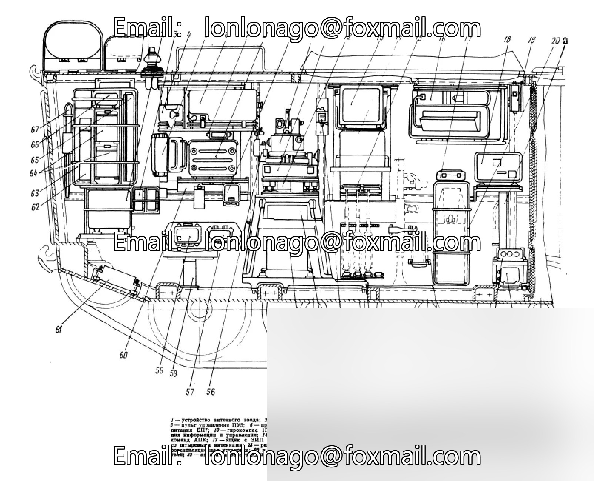
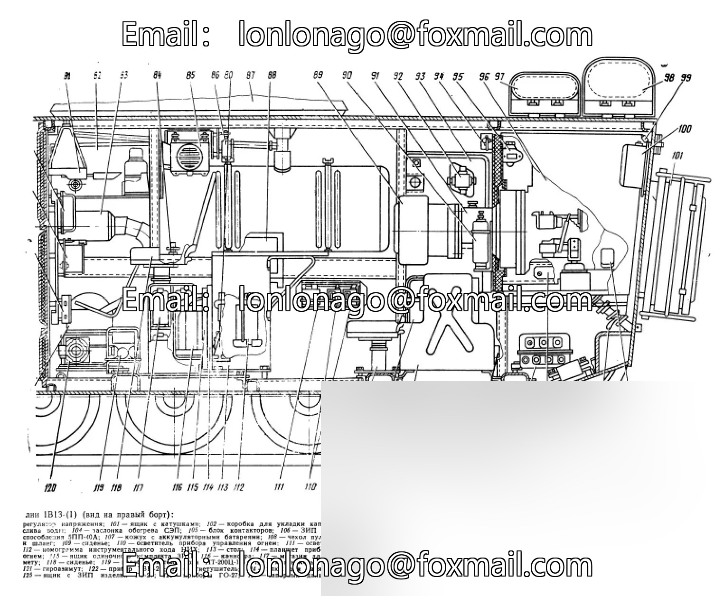
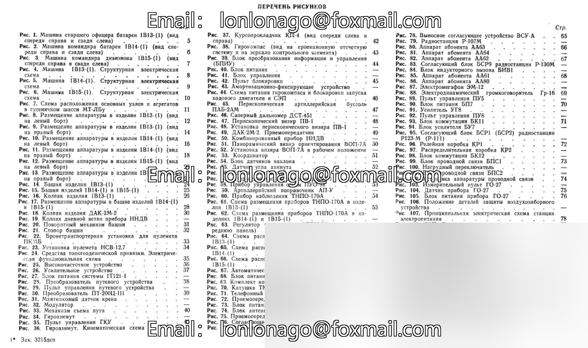
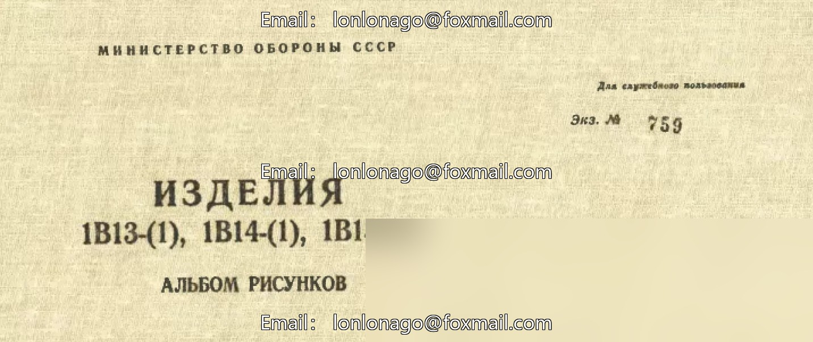
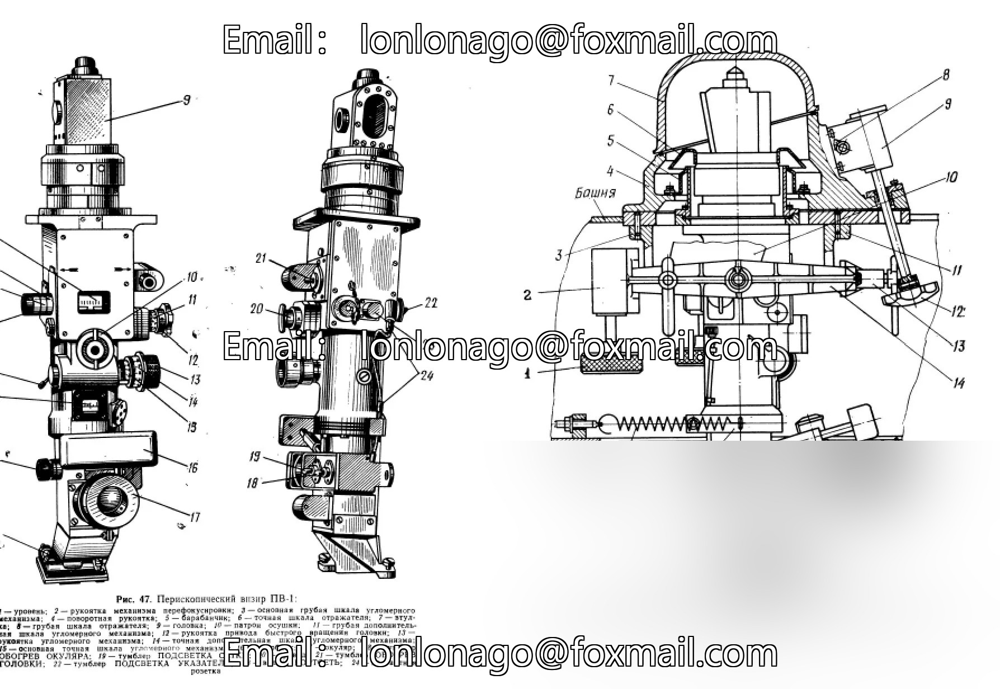
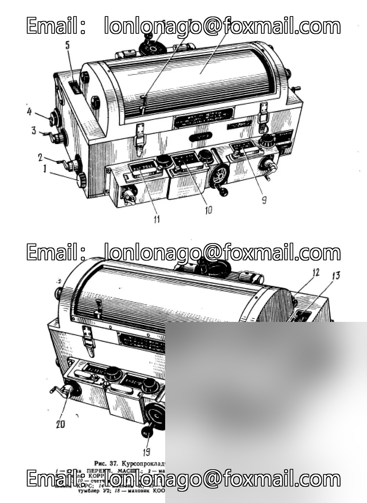

# The technical drawing of the Soviet Ministry of Defense's artillery command system formulated in the 1980s (internal materials)

## Body

The technical drawing collection of artillery command system compiled by the Soviet Defense Ministry in the 1980s (internal materials, serial number 759), mainly including engineering drawings of three types of standard equipment.

1B13-(1) - Automated fire control system of a mortar brigade (core component of the "Zoo Animal" -1 system)

1B14-(1) - Digital command terminal of Cannon Battalion Level

1B15-(1) - Frontier Observation Sentry Data Communication Device

Technical characteristics:

Adopting modular design standards GOST 2.601-68

The drawings shall be used in conjunction with the 《1V12 Series Equipment Technical Instructionbook》 (ТО1V12.00.000RЭ)

Classification level: "DSP" (internal restriction), the decryption year is usually after 1991.

Note: This series of equipment is a key component of the Soviet third-generation artillery automated command system (ASU "Mashina-B"), fielded in 1985.

This is a set of technical drawing materials compiled by the Soviet Ministry of Defense in the 1980s for artillery command systems, including engineering drawings and technical characteristics for various standard equipment.

<!-- AI_ENRICHED -->

## Images

## Payment

Here is a pay link on Stripe ( https://buy.stripe.com/3cs8yP7sY87d0vu9AB ). Please contact me lonlonago@foxmail.com after funding $89, and I will send you a complete data files , thank you!

